# Bulk Certificate Generator — Design

**Status:** draft v1.2 (pending approval; implementation plan follows via writing-plans skill)
**Changelog:** v1.2 — applies design-review amendments C1–C3, H1–H3 (H3 amended per verification), M1–M7, plus X1–X3 found during adversarial verification. v1.1 — builder-check amendments (§10.1–10.6).
**Date:** 2026-10-11
**Source assignment:** `Bulk_Certificate_Generator_Backend_Assignment.pdf`

> How to read this doc: prose defines the contract; mermaid diagrams define the
> behavior. If they ever disagree, the diagram wins and the prose gets patched.

---

## 1. Intent & why

A backend API that accepts **one request containing many recipients** and generates
a certificate PDF per recipient from a single predefined template, with per-job
progress tracking and retrieval.

Built as an interview-defensible assignment: every line explainable and modifiable,
every decision justified, tests for the required scenarios, docs for
setup / run / test / submit / retrieve.

---

## 2. Goals / Non-goals / Anti-goals

| Goals | Non-goals | Anti-goals |
|---|---|---|
| Bulk submission in one call | Template editor / multiple designs | One-API-call-per-certificate UX |
| Failure isolation per recipient | Email delivery / notifications | A design where one bad row kills a job |
| Honest, live progress tracking | Multi-tenant auth | Counters that drift from reality |
| Retrieval: list, per-cert PDF, job ZIP | Async streaming renderer rewrite | Redis/queue owning any critical state |
| Idempotent end-to-end | Horizontal scaling benchmarks | Multiple bespoke recovery paths |
| Verification URL + QR per certificate | S3 implementation (documented path only) | Recovery logic that lives in two places |

---

## 3. Constraints & decisions

**Stack (locked):** Python 3.14 · FastAPI + uvicorn · Postgres 16 via SQLAlchemy 2.0
async (asyncpg driver) · pydantic-settings · **Taskiq + Redis 7** (broker kept
swappable — RabbitMQ via `taskiq-aio-pika` is a one-line change) · Alembic ·
reportlab · testcontainers · Docker.

**Decisions (locked):**

- Hybrid validation rule — invalid rows become per-cert `FAILED` rows inside an
  accepted job; `422` only when **zero** rows are valid.
- Hybrid processing — validate + insert inline (the 202 receipt), fan-out in the
  queue (one `dispatch_job` task → N `generate_pdf` tasks).
- Disk storage with a swappable interface; S3 documented as the production path.
- Expanded statuses incl. `RETRYING`; verification URL + QR; cancel; ZIP download.
- Dockerfile + compose for `api` + `worker`.

**Defaults (mine — veto anytime):** `segno` for QR · 5,000 recipients/job cap ·
pagination 50 default / 200 max · CAS (compare-and-swap) status transitions as
*the* idempotency mechanism · certificate numbers `CERT-YYYY-XXXXXXXX` ·
soft-cancel semantics (in-flight certs finish) · optional `Idempotency-Key`
header · counts always derived via `GROUP BY` · DejaVuSans TTF vendored for
Unicode PDF rendering.

---

## 4. Architecture

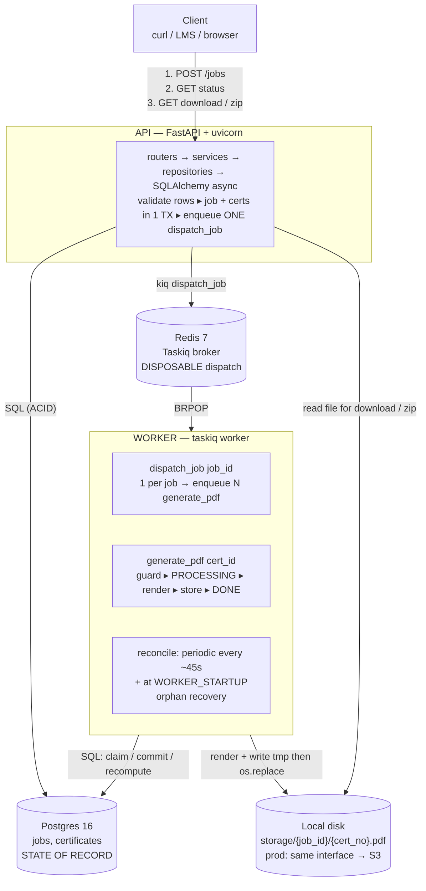

### Component responsibilities

| Component | Owns | Never owns |
|---|---|---|
| FastAPI routers | HTTP shape, 202/422/404/409 mapping | generation logic |
| job_service | row validation, transactional insert, dispatch enqueue | PDF internals |
| dispatch_job task | PENDING-cert scan → per-cert enqueue | job-level status decisions |
| generate_pdf task | claim → render → store → cert status, retry policy | job-level decisions |
| reconcile (periodic scheduler + worker startup) | reset stale certs, re-enqueue dispatch + certs, recompute stale jobs | client-visible state |
| storage service | write/read/zip of files (disk impl; S3-swappable) | DB records |
| Postgres | all truth: jobs, certs, statuses | queues |

### Key invariant

> **Postgres decides what is true. Redis decides what runs next.**
> Redis holds no state that isn't reconstructible from Postgres.

---

## 5. Request lifecycle (hybrid processing)

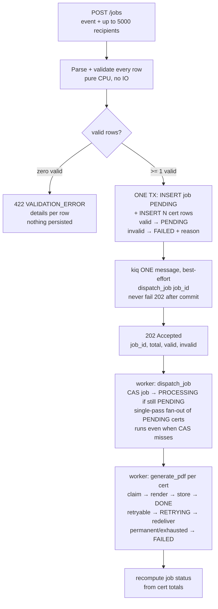

**Why here, not elsewhere:** the 202 response depends on validation results and
recipient rows, so they are inline (the client's receipt). Rendering is
slow / IO-bound / fallible, so it is queued. One dispatch task decouples Redis
availability from submission. Fully-deferred validation is a documented
escalation path for payloads above a large threshold.

Post-commit rule (M1): once the transaction commits, the request **always**
returns 202 — a `kiq` failure is logged, never a 500; periodic reconcile
(§10.6) guarantees pickup. Dispatch fan-out (M3/X1): a single
`SELECT id ... WHERE job_id = ? AND status = 'PENDING'` → enqueue each, and
fan-out runs **even when the job CAS misses** (a duplicate dispatch heals
partial fan-out; the claim CAS absorbs duplicates).

---

## 6. State diagrams

### 6.1 Job

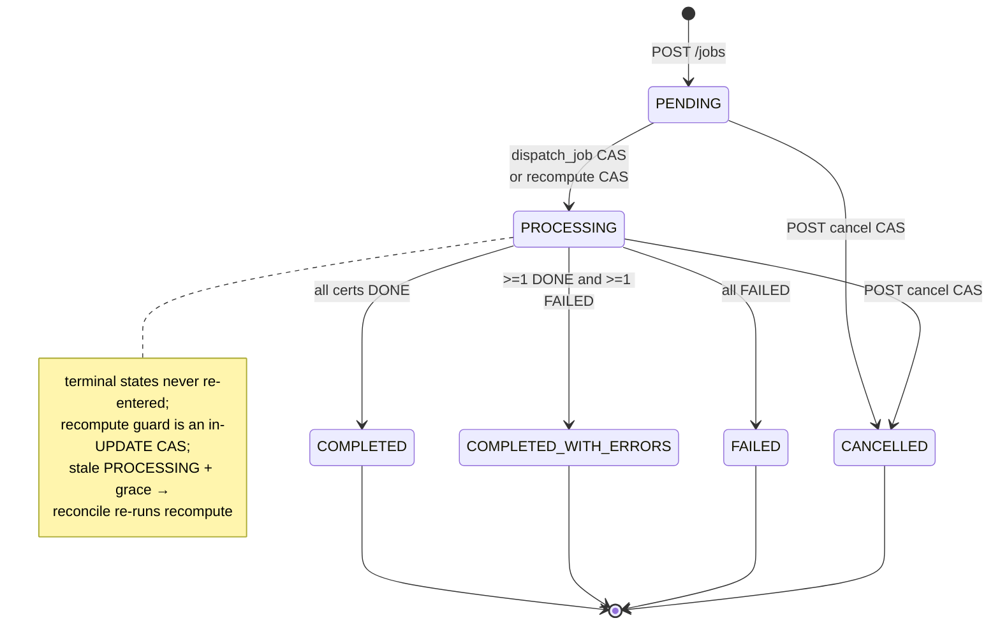

### 6.2 Certificate

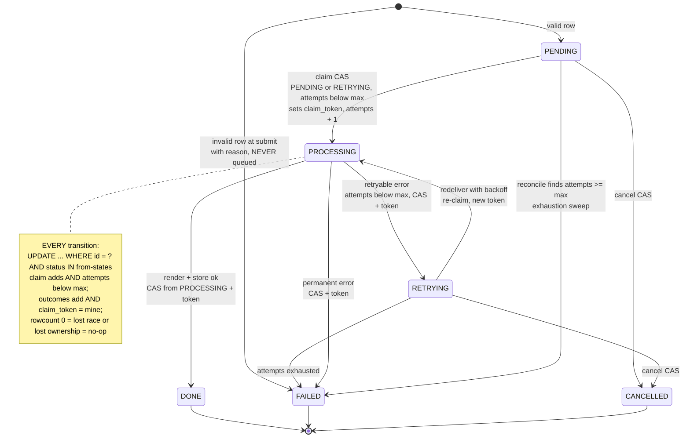

---

## 7. Sequence diagrams

### 7.1 Happy path

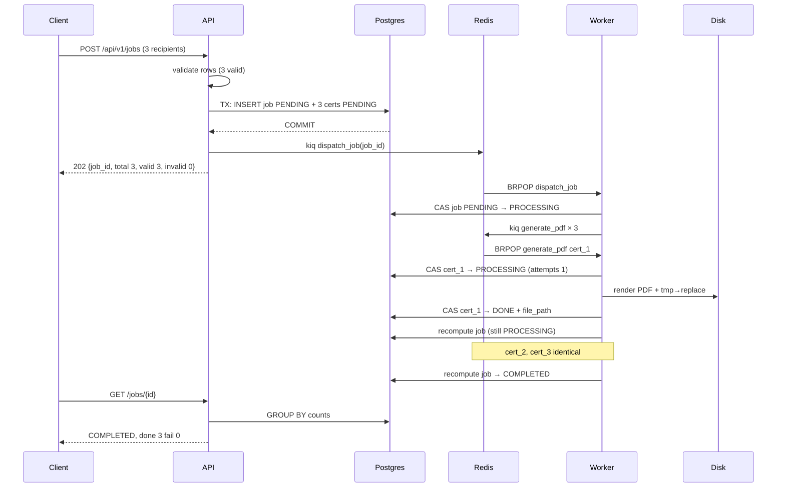

### 7.2 Mixed validity (hybrid validation rule)

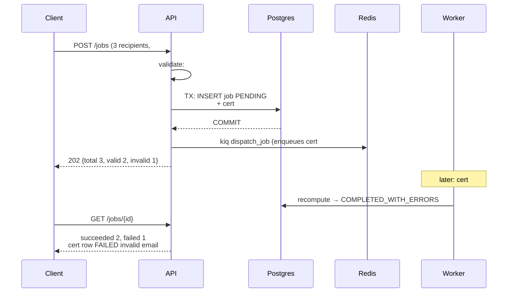

### 7.3 Retry (transient failure, attempts-capped)

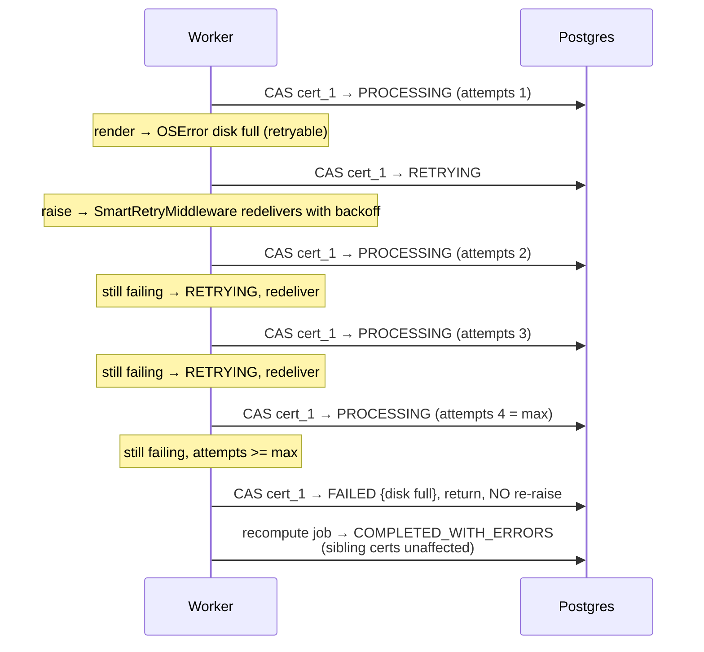

### 7.4 Cancel (soft cancel, idempotent)

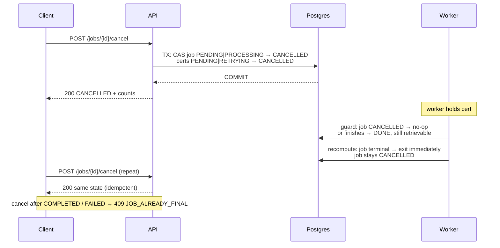

### 7.5 Duplicate delivery & crash recovery (the idempotency story)

```mermaid
sequenceDiagram
    participant W1 as Worker 1
    participant W2 as Worker 2
    participant P as Postgres
    participant R as Redis
    participant W as Worker reconcile

    Note over W1,W2: A. Duplicate delivery — two workers get same cert_id
    W1->>P: CAS cert → PROCESSING, sets claim_token (wins)
    W2->>P: CAS cert → PROCESSING (rowcount 0)
    Note over W2: status no longer PENDING|RETRYING → no-op return
    Note over W1: W1 dies before DONE → cert stuck PROCESSING<br/>periodic reconcile resets it; new claim overwrites token

    Note over W,P: B. PERIODIC reconcile every ~45s + WORKER_STARTUP covers everything below
    Note over W,P: API crash pre-enqueue · Redis flush<br/>worker crash mid-render · duplicate dispatch<br/>crash between final DONE and recompute
    W->>P: reset stale: CAS PROCESSING|RETRYING<br/>with updated_at older than grace DB now → PENDING<br/>attempts >= max → FAILED instead, then recompute
    W->>R: enqueue dispatch_job for stale PENDING jobs
    W->>P: recompute stale PROCESSING jobs<br/>updated_at older than grace DB now
    W->>R: enqueue generate_pdf for every PENDING cert
    Note over W,P: duplicate enqueues are normal;<br/>claim guard from A makes them no-ops;<br/>reset never checks claim_token, claim overwrites it

    Note over W1,W2: C. Re-claim split-brain — stall exceeds grace, both workers live
    W1->>P: CAS cert → PROCESSING token T1, stalls over 120s
    W->>P: reconcile resets stale PROCESSING → PENDING
    W2->>P: CAS cert → PROCESSING token T2, attempts + 1
    W1->>P: CAS PROCESSING → FAILED AND token T1 → rowcount 0, no-op
    Note over W1: stale owner cannot clobber; only token holder writes
    W2->>P: CAS PROCESSING → DONE AND token T2 → succeeds

    Note over P,R: C. Deterministic outputs
    Note over P,R: file path = f job_id, cert_no<br/>write tmp then os.replace = identical bytes<br/>recompute = pure function of cert rows
```

### 7.6 Retrieval & verification

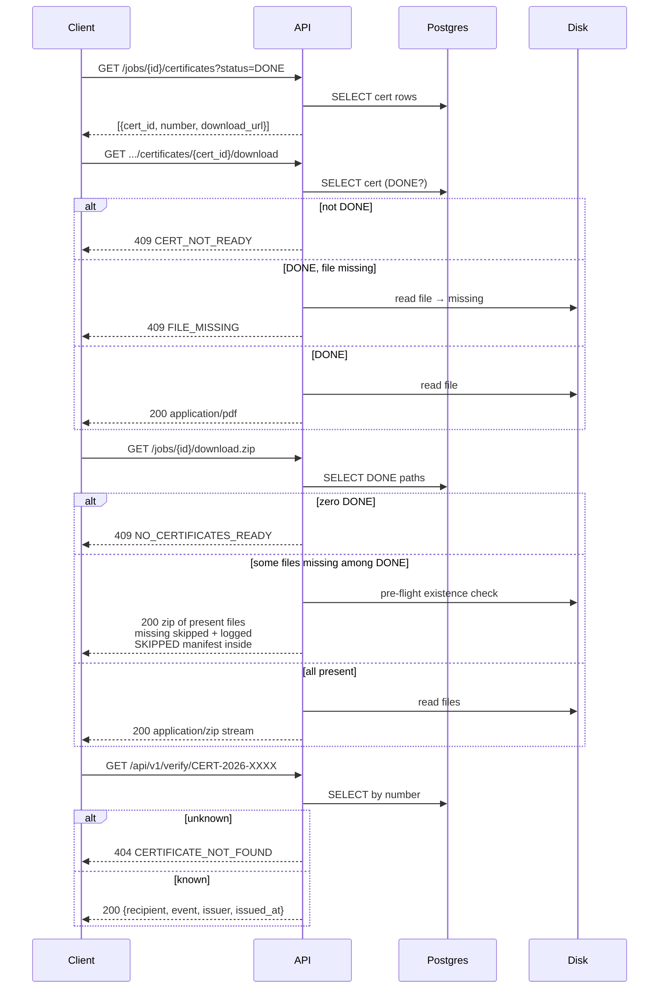

---

## 8. API spec

**Conventions** — base path `/api/v1`, JSON, timestamps ISO-8601 UTC. All errors
share one envelope:

```json
{ "error": { "code": "STRING_CODE", "message": "human readable", "details": [] } }
```

**Enums:** `JobStatus = PENDING | PROCESSING | COMPLETED | COMPLETED_WITH_ERRORS | FAILED | CANCELLED`
· `CertificateStatus = PENDING | PROCESSING | RETRYING | DONE | FAILED | CANCELLED`

### 8.1 `POST /api/v1/jobs` — submit a bulk job

Header: `Idempotency-Key: <opaque string>` (optional, stored as text; UUID recommended).

Request:

```json
{
  "event_name": "Advanced Robotics Workshop 2026",
  "event_date": "2026-03-15",
  "issuer": "Aereo Academy",
  "description": "For successful completion of the 40-hour program.",
  "recipients": [
    { "name": "Dhwanil Shah", "email": "d@x.com",
      "extra_metadata": { "score": 95, "grade": "A+" } },
    { "name": "Bad Row", "email": "not-an-email" }
  ]
}
```

Validation rules:

| Field | Rule |
|---|---|
| `event_name`, `issuer` | required, 1–200 chars, trimmed |
| `event_date` | required, `YYYY-MM-DD` |
| `description` | optional, ≤1000 chars |
| `recipients` | required array, 1–5000 |
| `recipients[].name` | required, 1–200 chars after strip |
| `recipients[].email` | required, valid email format |
| `recipients[].extra_metadata` | optional, ≤10 keys, values string/int/bool ≤200 chars |

Responses:

- `202` — `{job_id, status: "PENDING", total, valid, invalid, created_at}`.
- `422 VALIDATION_ERROR` — zero valid rows; `details[]` carries
  index/field/message. Schema-level parse errors use the same envelope with
  field paths.
- `409 IDEMPOTENCY_KEY_REUSED` — same key, different payload.
- Replay of the same key + same payload → original `202` body verbatim plus
  `Idempotency-Replayed: true` header (see §10.5).

Concurrency (M2): two racing submits with the same key — the loser's `INSERT`
hits the UNIQUE constraint → catch `IntegrityError` → `SELECT` the existing
row → compare `request_hash` → same payload replays the stored snapshot
(`202` + header), different payload returns `409`. All inside the same
request; never a 500.

### 8.2 `GET /api/v1/jobs` — list jobs

Query: `status?`, `page=1`, `size=50 (≤200)`. Response `200`:

```json
{ "items": [ { "job_id": "uuid", "event_name": "...", "status": "PROCESSING",
    "counts": { "total": 3, "done": 0, "failed": 1, "pending": 2,
                "retrying": 0, "cancelled": 0 },
    "created_at": "...", "completed_at": null } ],
  "page": 1, "size": 50, "total_items": 12, "total_pages": 1 }
```

### 8.3 `GET /api/v1/jobs/{job_id}` — job detail

`200` — single item of the same shape + `event_date`, `issuer`, `updated_at`.
`404 JOB_NOT_FOUND`.

### 8.4 `POST /api/v1/jobs/{job_id}/cancel`

`200` — `{job_id, status: "CANCELLED", counts: {...}}`, idempotent on
already-cancelled. `404 JOB_NOT_FOUND`. `409 JOB_ALREADY_FINAL` when status ∈
`{COMPLETED, COMPLETED_WITH_ERRORS, FAILED}`.

### 8.5 `GET /api/v1/jobs/{job_id}/certificates` — per-recipient rows

Query: `status?`, `page`, `size`. `200`:

```json
{ "items": [ { "certificate_id": "uuid", "recipient_name": "...",
    "recipient_email": "...", "status": "FAILED",
    "certificate_number": "CERT-2026-7K3D9F2A", "attempts": 3,
    "error_message": "disk full", "download_url": null,
    "generated_at": null } ],
  "page": 1, "size": 50, "total_items": 3, "total_pages": 1 }
```

`download_url` is populated only when status = `DONE`.

### 8.6 `GET /api/v1/jobs/{job_id}/certificates/{cert_id}/download`

`200` `application/pdf`,
`Content-Disposition: attachment; filename="CERT-2026-7K3D9F2A.pdf"`.
`404 CERT_NOT_FOUND` · `409 CERT_NOT_READY` (status ≠ DONE) ·
`409 FILE_MISSING` (DONE, file gone).

Policy for DONE-but-missing (X2): download/ZIP return 409 (or a partial ZIP
with manifest, §8.7) and the row **stays** DONE — files are addressed by
deterministic path and re-render is out of scope; recovery is operational
(restore the volume from backup, downloads succeed with no DB change).
Reconcile never demotes DONE.

### 8.7 `GET /api/v1/jobs/{job_id}/download.zip`

`200` `application/zip` stream of every DONE cert whose file exists
(filenames = certificate numbers). A pre-flight existence check runs before
streaming begins; missing files are skipped, logged, and listed in a
`SKIPPED.txt` manifest inside the ZIP. `404 JOB_NOT_FOUND` ·
`409 NO_CERTIFICATES_READY` (zero DONE).

### 8.8 `GET /api/v1/verify/{certificate_number}`

`200` — `{certificate_number, recipient_name, recipient_email, event_name,
event_date, issuer, status, issued_at, job_id}` (`status` reflects the live
cert status; `issued_at` null until DONE). A number that exists but isn't DONE
still returns `200` with its status — verification shows the truth, never a
404 for an existing number. `404 CERTIFICATE_NOT_FOUND` only for unknown
numbers.

### 8.9 `GET /health`

`200` — `{status: "ok", checks: {database: "ok", redis: "ok"}}`.
`503` with per-check detail on failure.

---

## 9. Data model

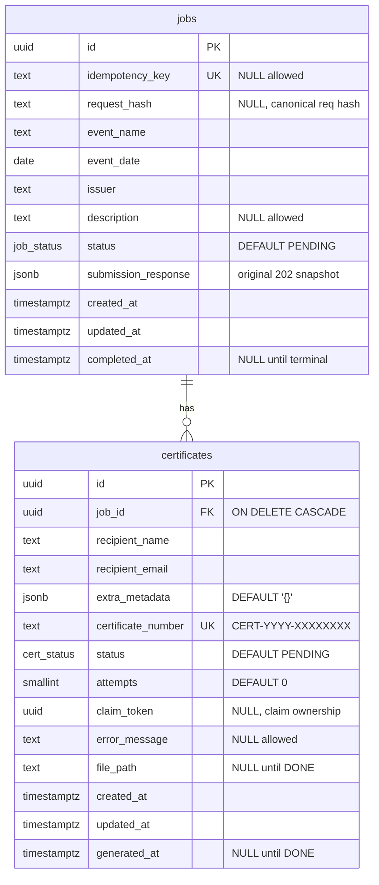

DDL sketch (Alembic migration implements this exactly):

- `jobs(id uuid PK DEFAULT gen_random_uuid(), idempotency_key text UNIQUE NULL,
  request_hash text NULL, event_name text NOT NULL, event_date date NOT NULL,
  issuer text NOT NULL, description text NULL,
  status job_status NOT NULL DEFAULT 'PENDING', submission_response jsonb NULL,
  created_at/updated_at timestamptz NOT NULL DEFAULT now(),
  completed_at timestamptz NULL)`
- `certificates(id uuid PK DEFAULT gen_random_uuid(),
  job_id uuid NOT NULL REFERENCES jobs(id) ON DELETE CASCADE,
  recipient_name text NOT NULL, recipient_email text NOT NULL,
  extra_metadata jsonb NOT NULL DEFAULT '{}',
  certificate_number text NOT NULL UNIQUE, status cert_status NOT NULL DEFAULT
  'PENDING', attempts smallint NOT NULL DEFAULT 0, claim_token uuid NULL,
  error_message text NULL, file_path text NULL,
  created_at/updated_at timestamptz NOT NULL DEFAULT now(),
  generated_at timestamptz NULL)`
- Indexes: `certificates(job_id, status)` · `jobs(idempotency_key)` ·
  `jobs(status, created_at)`.

Counts are **never stored as columns** — always
`SELECT status, count(*) ... GROUP BY` per job. One source of truth, zero drift.

---

## 10. Idempotency (every part of the system)

| # | Operation | Mechanism | Guarantee on retry / duplicate |
|---|---|---|---|
| 1 | `POST /jobs` (with key) | UNIQUE `idempotency_key` (text) + `request_hash` (sha256 over canonical JSON) + `submission_response` snapshot; concurrent race resolved via IntegrityError → SELECT → compare → replay/409 | Replay → identical `202` + body + `Idempotency-Replayed: true`; same key *different* payload → `409` |
| 2 | `POST /jobs` (no key) | — (documented) | Client's choice; duplicate job expected |
| 3 | `dispatch_job` | single-pass `SELECT id ... WHERE job_id=? AND status='PENDING'` → enqueue each; fan-out runs even when the job CAS misses | Re-run re-enqueues safely; claim CAS absorbs duplicates |
| 4 | `generate_pdf` claim | CAS `UPDATE ... WHERE status IN (PENDING,RETRYING) AND attempts < :max`, sets fresh `claim_token`, `attempts+1` | Concurrent duplicate or attempts-exhausted → rowcount 0 → **no-op** |
| 5 | cert `→ DONE`/`RETRYING`/`FAILED` | CAS from `PROCESSING AND claim_token=:mine`; tmp→`os.replace` to deterministic path | Stale owner cannot clobber; identical bytes on rewrite |
| 6 | Job status recompute | pure function of cert rows; terminal guard is an in-`UPDATE` `WHERE status NOT IN (...)` CAS | Re-runs converge; cancel can never be un-done |
| 7 | Periodic `reconcile` (~45s) + startup | stale certs → `PENDING` (`attempts>=max` → `FAILED` + recompute); stale `PENDING` jobs → dispatch; stale `PROCESSING` jobs → recompute; all comparisons use DB `now()` | Re-runs safe; absorbs #4's leftovers; no restart needed |
| 8 | `POST cancel` | CAS from `PENDING\|PROCESSING` | Repeat → `200` same state; racing completion → `409` |
| 9 | All `GET`s, download, zip, verify | read-only; deterministic paths | Naturally idempotent |

### 10.1 Retry mechanics (the state enforces the cap, not the middleware)

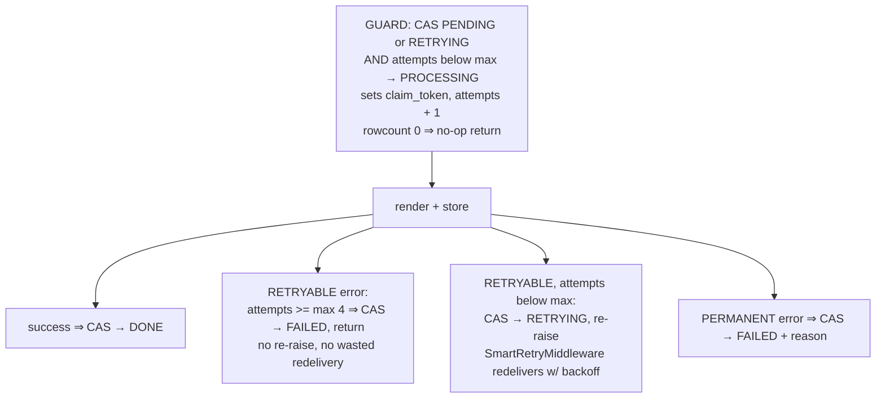

`SmartRetryMiddleware`'s own retry count is configured ≥ 4 as a second fence,
but the **DB `attempts` column is the authoritative cap**: even if the
middleware gives up first, the next claim still enforces the limit. Exhausted
certs land in `FAILED` (terminal) — reconcile never touches `FAILED`, so stale
`RETRYING→PENDING` recovery is bounded by the persisted counter. No infinite loop.

Every outcome transition (`DONE`/`RETRYING`/`FAILED`) adds
`AND claim_token = :mine` — a stalled-then-reset worker can no longer clobber
the new owner's row (C3); rowcount 0 means lost ownership, no-op. Reset never
checks the token; each claim overwrites it. Crash-at-cap path (H3): a cert
reset while `attempts >= max` is swept `PENDING → FAILED` by reconcile (with
recompute) instead of being re-claimed — the claim predicate alone would
strand it in `PENDING` forever.

**Retryable taxonomy:** **transient** — `OSError` (disk full/permissions),
DB/Redis *connection* errors → retry. **Permanent** — everything else
(reportlab render failures, `ValueError` on bad data, unknown bugs): fail fast
and make the failure visible rather than retrying a deterministic bug.

### 10.2 Job recompute rules (explicit, complete)

```
decision = f(cert rows):
  all certs DONE                                → COMPLETED
  ≥1 DONE AND ≥1 FAILED                         → COMPLETED_WITH_ERRORS
  all FAILED (and total > 0)                    → FAILED
  otherwise                                     → PROCESSING   (from PENDING or PROCESSING)

UPDATE jobs
   SET status = :decision,
       completed_at = COALESCE(completed_at,
                               CASE WHEN :decision IN
                                 ('COMPLETED','COMPLETED_WITH_ERRORS','FAILED','CANCELLED')
                               THEN now() ELSE NULL END),
       updated_at = now()
 WHERE id = :id
   AND status NOT IN ('COMPLETED','COMPLETED_WITH_ERRORS','FAILED','CANCELLED');
```
Rowcount 0 means the job went terminal concurrently (e.g. cancel won the
race) — the write is dropped, never an un-cancel (H2). `completed_at` is set
exactly once, on first terminal entry.

After a soft cancel, in-flight certs finishing (`DONE`/`FAILED`) update their
own rows but the `WHERE` clause drops the job write — the job stays `CANCELLED`.

Stale `PROCESSING` jobs (C2): reconcile treats
`status IN (PENDING, PROCESSING) AND updated_at < now() - grace` as stale —
stale `PENDING` → dispatch, stale `PROCESSING` → recompute re-run. This closes
the crash-between-final-`DONE`-and-recompute window: recompute on an already
settled job harmlessly rewrites the same terminal state. Recompute's legal
from-states are `{PENDING, PROCESSING}` (M7): a cert may finish before the
dispatch CAS runs, so `PENDING → PROCESSING` via recompute is valid.

### 10.3 Unicode in the PDF

Vendor `DejaVuSans.ttf` + `DejaVuSans-Bold.ttf` into `assets/fonts/`
(OFL-licensed, freely redistributable), register with
`reportlab.pdfbase.ttfonts.TTFont`. Accented and CJK names render correctly;
Dockerfile copies `assets/`. Unit tests assert on accented (`Dhwaníl`) and CJK
names. reportlab's built-in Helvetica is Latin-1 only — this is why the font is
vendored rather than assumed.

### 10.4 Certificate numbers

`CERT-<year-of-job-created_at>-<8 random base32 chars>`; on unique-constraint
collision → regenerate (bounded at 5 attempts, then permanent failure). The
verify endpoint is keyed on this number, so the rule is part of the contract.

### 10.5 Idempotency replay

On job creation, store two submit-time facts: `request_hash` — sha256 over a
canonical JSON encoding of the request body (key order normalized, whitespace
stripped) — and the response snapshot as `jobs.submission_response` JSONB.
Both immutable (separate from the derived-counts rule, which governs live
status only). Replay with the same key + same hash returns the original `202`
body verbatim plus an `Idempotency-Replayed: true` header; same key +
different hash returns `409 IDEMPOTENCY_KEY_REUSED`. Current state is always
fetched via `GET /jobs/{id}`. Keys are opaque client strings stored as `text`
(UUID recommended); concurrent same-key submits resolve via the
IntegrityError → SELECT → compare → replay/409 branch (§8.1).

### 10.6 Reconcile staleness

Reconcile runs as a **periodic scheduled task** (Taskiq scheduler, every
`reconcile_interval_seconds = 45`) **and** once at worker startup — one
implementation, two triggers (C1). Startup is the special case
`reconcile(now)`; steady-state recovery never needs a restart.

A job is stale when `status IN (PENDING, PROCESSING) AND updated_at < now() - grace`;
a cert is stale when `status IN (PROCESSING, RETRYING) AND updated_at < now() - grace`.
Stale `PENDING` jobs → enqueue dispatch; stale `PROCESSING` jobs → run
recompute (C2); stale certs with `attempts >= max` → `FAILED` + recompute,
otherwise → `PENDING` + enqueue (H3). Every job-row update (create, dispatch,
recompute) bumps `updated_at`, so a restart 30s after creation does *not*
false-positive.

Clock + tuning invariants (M5): `now()` is always the **database clock**
(`func.now()` / `now()` in SQL), never app time — app/worker clocks may skew.
And `retry_backoff_seconds × max_generation_attempts < reconcile_grace_seconds`
must hold (5 × 4 = 20s ≪ 120s today); otherwise reconcile steals in-flight
backoffs. Both are asserted next to the config knobs in §11.

---

## 11. Configuration (pydantic-settings)

`database_url` · `redis_url` · `storage_dir` (default `./storage`, gitignored) ·
`base_url` (verify links + QR) · `max_recipients_per_job=5000` ·
`max_generation_attempts=4` (1 try + 3 retries) · `retry_backoff_seconds=5` ·
`reconcile_grace_seconds=120` · `reconcile_interval_seconds=45` ·
`page_size_default=50` / max 200 · `log_level` · `app_name`, `environment`.

Invariants: staleness uses DB `now()`; keep
`retry_backoff_seconds × max_generation_attempts (20s) < reconcile_grace_seconds (120s)`.

---

## 12. Testing strategy

- **Unit tests (no infra):** renderer produces valid PDF bytes containing the
  recipient name (incl. accented + CJK fixtures); row validation (per-row
  isolation, zero-valid case); `generate_pdf` guard/retry logic via Taskiq
  `InMemoryBroker` + `tmp_path` storage; job recompute as a pure function.
- **Integration tests (testcontainers → real Postgres + Redis):** the six
  required scenarios — create job, input validation, generation,
  status/progress, per-cert failure, retrieval — plus cancel, retry→`RETRYING`,
  reconcile after simulated crash/duplicate enqueue, idempotency-key replay
  (incl. concurrent same-key submits), split-brain token test (stale owner's
  outcome is a no-op), exhaustion sweep (`attempts=max` → `FAILED`),
  cancel-vs-recompute race, stale-`PROCESSING`-job recompute, zip, verify
  (incl. non-DONE numbers), `/health`.
- Migrations are applied once per test session against the throwaway Postgres.

---

## 13. Deployment

`docker-compose.yaml`: `postgres:16`, `redis:7`, `api` (uvicorn, migrations on
boot), `worker` (taskiq worker + taskiq scheduler processes for the periodic
reconcile — same image, two commands).
Multi-stage `Dockerfile` built on `uv` (pin exact `taskiq`/`taskiq-redis`
versions; confirm CLI + middleware kwargs at build time); `assets/` copied for
fonts; storage dir mounted as a volume. README documents
`docker compose up --build` as the one-command path.

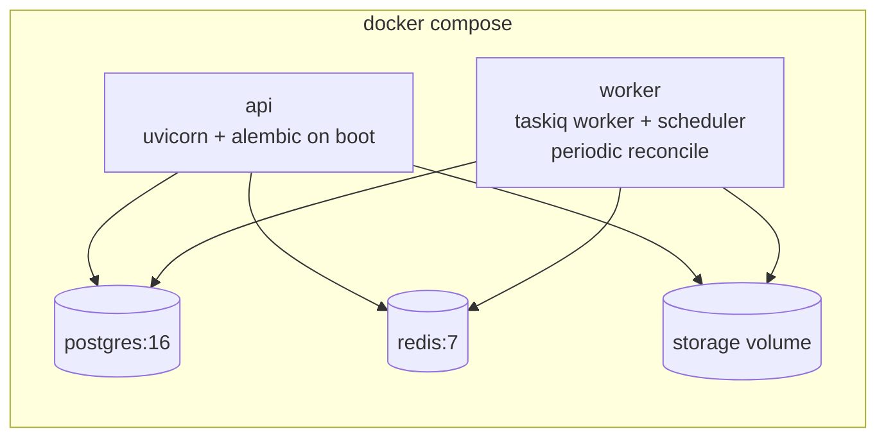

---

## 14. Design rationale (the justification section)

| Decision | Alternative | Why |
|---|---|---|
| Hybrid processing | All-inline (O(N) enqueue) / all-deferred | 202 receipt needs counts+rows inline; queue decouples Redis availability; dispatch task is the seam |
| Hybrid validation | Strict 422 / blind accept | Max resilience *and* a real input contract; invalid rows stay visible as failures |
| Taskiq + Redis | ARQ / Celery+RabbitMQ | Async-native; DI for testable tasks; broker is a swappable config line (RabbitMQ via `taskiq-aio-pika`); Redis never holds state |
| Per-cert fan-out | One task processes whole job | Independent retry per certificate = structural failure isolation |
| Derived counts | Columns updated per cert | One source of truth, no drift, no lost-update races |
| CAS transitions everywhere | Optimistic app-level checks / constraints alone | Every mutation idempotent under duplicate delivery — one mechanism covers retries, crashes, reconciliation |
| Disk storage | Postgres bytea / S3-only | Simple, fast, swappable interface; S3 documented as the production target |
| reportlab + vendored TTF | WeasyPrint / Pillow | Pure-wheel install, programmatic control, Unicode-safe, easy to test and explain |

**Interview one-liner:** *"State lives in Postgres; the queue is disposable
dispatch. Taskiq keeps the broker a config swap — RabbitMQ is one line — and
DI plus InMemoryBroker make every task unit-testable with zero infra. Every
mutation is a CAS transition, so retries, crashes, and reconciliation all
converge through one mechanism."*

---

## 15. Left to the builder

The implementation plan itself (next step: writing-plans skill). Also: pin the
exact `taskiq`/`taskiq-redis` version and confirm CLI + middleware kwargs at
build time; finalize the PDF's visual polish; decide whether `.kiq` result
handling needs any logging hooks. Choose the reconcile trigger implementation
(Taskiq scheduler vs system cron) at build time; the contract (every ~45s +
startup, §10.6) is fixed.
